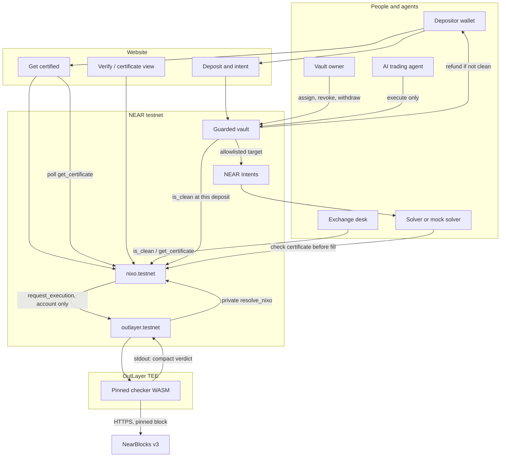

# NIXO product requirements

**Version:** this hackathon submission and the product it is meant to become
**Date:** 14 November 2026, Asia/Calcutta
**Network for this version:** NEAR testnet, with a mainnet history demo for the documented hack trail
**One-liner:** NIXO is a clean-funds passport and a gated trading layer for NEAR. It checks the source of funds inside a trusted execution environment, lets an AI agent trade only certified deposits under limits the contract enforces, and lets solvers refuse an intent that is not clean.

This is the product Sweta wants to ship: three layers that feed each other. The tracer creates trust. The vault puts that trust to work. The solver layer spreads the same check across the NEAR Intents network.

Privacy is stated honestly throughout: the strategy can be private inside a TEE, the trade log is encrypted and readable with viewing keys, and fund history is checked without being revealed. NIXO does not hide trades on-chain.

---

## 1. Problem

Exchanges, vaults and AI trading agents need to know whether incoming funds are tied to sanctioned or stolen money. Today that usually means handing a full transaction history to a central screener, or trusting an agent with a hot wallet and hoping it behaves.

That creates three failures:

- **A compliance check leaks the history.** Counterparties, balances and routes become visible to whoever runs the check.
- **An account-level “looks fine” is treated as a property of the coins.** A wallet can be certified once, then receive dirty money, then deposit. Trust must be checked at the moment funds move, and recorded per deposit.
- **Agents and solvers have no shared gate.** A prompt-injected agent, or a solver filling any intent, can move money a human would have refused.

NIXO addresses this on NEAR. A pinned checker runs in an OutLayer TEE (Intel TDX), looks up history itself, and writes a short certificate to `nixo.testnet`. The vault, and later any solver, reads `is_clean` and acts on that verdict. They see the verdict, the reason, the checker version and the expiry — not the path, the balances or the counterparties.

NIXO is **bounded on-chain provenance screening**, not a proof that particular coins are clean in the legal or AML sense. The product must say so.

---

## 2. Users and personas

**Depositor (Alice).** A person or fund who wants an AI agent to trade on a stated intent, such as “grow my NEAR, at most 2 NEAR per trade.” She needs a certificate she can obtain from the website, a vault that will accept only a currently valid clean certificate, and a way to revoke the agent and withdraw what is left. She may sell or share a viewing key so someone else can read the encrypted trade log, not the live chain activity.

**Exchange or withdrawal desk.** Needs a yes-or-no gate before accepting a payout or a deposit. Calls `is_clean(account)` and, if useful, `get_certificate`. Must not be shown a hop path or a balance. Warn and expired certificates are refused.

**Solver.** A NEAR Intents solver, or any routing service filling intents. Before filling or routing, it checks the certificate of the originating account (and, when the API allows, the destination). It should fail closed if the certificate is missing, expired, a warning, or a rejection.

**Agent developer.** Builds or configures a trading agent that maximises profit within the user’s intent. The agent holds only a function-call key for `execute`. It must not be able to raise its own limits, call a dex directly, or move funds after revoke. The contract is the authority, never the Python or model process.

---

## 3. User journeys

### 3.1 Get certified

1. The user connects a NEAR wallet on the website and clicks **Get certified**.
2. The contract asks OutLayer to run the pinned checker with the account only. No history is uploaded by the website.
3. The page shows pending, then polls `get_certificate`.
4. On success, it shows verdict, reason, expiry, checker version and history source (indexer and block height). There is no hop path on a certified result.
5. Failed and timed-out checks are shown as failed, not clean. An expired certificate is shown as expired, and the user is asked to recertify.

The indexer network must match the account (testnet accounts against the testnet indexer, mainnet accounts against mainnet). The site must not silently check the wrong network.

### 3.2 Deposit, assign, trade, revoke, withdraw

1. After a currently valid Clean certificate, the user deposits into the vault.
2. The vault calls `is_clean` in a cross-contract call. Warn, rejected, missing and expired all refund, and no provenance record is written.
3. A clean deposit creates its own provenance record (`clean_at_deposit` is true only for this deposit, at this moment). It does not inherit an older wallet certificate.
4. The owner assigns that deposit to an agent, with per-transaction, per-window and expiry limits, plus allowed targets (the Intents entry point or a mock exchange in tests).
5. The user states an intent (goal, constraints, risk limits). The agent may plan in a TEE-hosted model. It trades only by calling `execute`. The contract re-checks permissions, remaining balance, `clean_at_deposit`, and the allowlist on every call.
6. The owner can revoke at any time. Further `execute` calls fail. Unspent funds stay in the deposit for withdrawal.
7. The owner withdraws the remainder.

### 3.3 Selective disclosure

Trade details are written to an encrypted log. Hashes of trades may be committed on-chain. A viewing key (delayed, live, time-limited, or auditor) lets the holder decrypt the log for its scope. Selling a key re-encrypts the data key to the buyer and writes a receipt. A viewing key does not hide the vault’s on-chain transfers from an explorer.

### 3.4 Solver check

A solver, or the mock solver in the demo, receives an intent. It calls `is_clean` (and optionally `get_certificate`) on the originating account. Alice’s intent can be filled. Mallory’s is refused, with the reason visible to the solver, not a reconstructed hop path. An outside agent that wants to trade through Intents uses the same check before it routes.

---

## 4. Requirements by layer

### 4.1 Layer 1 — Fund tracer

A Rust checker, compiled to WebAssembly, runs in the OutLayer TEE. Formal proofs (Kani) cover the pure decision cores: a listed address cannot be found clean, and the search always stops. Those cores must not be rewritten for live history.

**Lists.** Pinned, compiled-in snapshots (OFAC, EU, UK, UN, Switzerland SECO, and a known-hackers list), with a dated list snapshot and a hash in the output.

**What a check does.**

1. Screen the account and its direct counterparties against the lists, in both directions.
2. Search backward up to six hops, following money only forward in time.
3. Treat a pool hop as a link when opposite-direction swaps in the same venue and pool occur within 120 seconds and amounts are within 15% (1,500 basis points). A gap over 1,200 basis points makes the link weak.
4. Choose an outcome in this order: a strong taint path yields Rejected (`taint_path`); an incomplete search yields Rejected (`history_incomplete`); a weak-only path yields Warn (`taint_path`); otherwise Clean.
5. Other fail-closed reasons: `list_hit`, `list_unavailable`, `malformed_input`, `history_unavailable`.

**Modes.**

- **Certified.** Input is the account (and optionally a network that must match the account). History is fetched inside the enclave from NearBlocks API v3, pinned to a block, or — only when a documented offline switch is on — from a compiled fixture labelled as a fixture. The caller must not supply the history. Output has no path, stays under 900 bytes, and includes verdict, reason, hops, checker version, list snapshot and hash, trace depth, history source (for example `nearblocks-v3:testnet@h=<height>`), and an input hash over the account, the pin and the normalised history.
- **Preview.** The caller may supply history. The result is marked caller-supplied. The contract must refuse to certify it.

**Live history (this version).** Rebuild the checker for `wasm32-wasip2` so it can make HTTPS calls through `wasi:http`. Fetch from `api-testnet.nearblocks.io` or `api.nearblocks.io` as appropriate. Pin `/v3/blocks/latest`, then read transactions, fungible-token transfers and swap details with `before_ts` and a height cap. Expand counterparties under compiled caps. Known faucets, system accounts and dex venues are terminal: they are still list-checked, but not expanded, so a new testnet user funded only by a faucet is not rejected as incomplete. A failed fetch or a cap on a non-terminal account never yields Clean. Fixtures stay as a labelled offline fallback and must not be used silently when a live fetch fails. Publish the checker as an OutLayer project so an indexer API key can be injected as an author secret. Update `checker_hash` on `nixo.testnet` after every rebuild.

`nixo.testnet` asks OutLayer to run the pinned WebAssembly, receives the result on the private `resolve_nixo` callback, and stores one certificate per account (verdict, reason, issued time, expiry, checker hash, list snapshot). There is no signature and no certificate identifier. `is_clean(account)` is true only for a currently valid Clean certificate. Warn, rejected, missing and expired are not clean.

**Acceptance criteria**

- Alice (clean demo) can be certified Clean; Mallory is Rejected with a reason.
- A live certify of a fresh testnet account, funded only from a documented faucet, completes without being marked incomplete merely because the faucet is large.
- The documented mainnet hack trail (`normalherb1811.near`, the d368… intermediate, and the MEILI pool-9009 hop to `farstreet4572.near`) is Rejected or Warn according to the stated rules, fetched from the mainnet indexer, with the network named in `history_source`.
- Asking the testnet indexer to fetch a mainnet account, or the reverse, fails closed.
- Certified output is under 900 bytes and contains no path.
- A timeout, a 429, truncated data, or a cap on a non-terminal account is Rejected (`history_unavailable` or `history_incomplete`), never Clean.
- Preview results cannot be written as certificates.
- Existing Kani proofs still pass.

### 4.2 Layer 2 — Deposit vault and AI trading agent

The vault holds the funds. The agent never holds them. The contract decides, not the Python agent.

**Deposit gate.** `deposit` calls `nixo.testnet.is_clean(depositor)` and only creates a provenance record in the private callback. Each deposit is its own provenance event: depositor, amount, remaining, `clean_at_deposit`, time of the check, status, and optional assignee. A dirty, warning, missing or expired certificate is refunded and gets no record. Users certify first, then deposit.

**Permissions.** The owner assigns a deposit to an agent with:

- a maximum per transaction
- a maximum per time window
- a permission expiry
- an allowlist of targets (NEAR Intents or the test stand-in)

The agent’s key is a function-call key that can only call `execute`. `execute` runs these checks in order and stops at the first failure: permission exists; not revoked; not expired; deposit assigned to the caller; `clean_at_deposit` is true; amount within the per-transaction cap; amount within the window cap; amount within remaining; target is allowlisted. Spent and remaining are updated before the outbound call and rolled back if the swap fails.

**Lifecycle.** Deposit → assign → trade → revoke → withdraw. Revoke clears the assignment, rejects later `execute` calls, and leaves unspent funds for the owner to withdraw. Deleting the function-call key is optional; the vault already rejects the caller.

**User intent and the agent.** The user states a goal and limits (for example, “maximise profit in NEAR, at most 2 NEAR per trade, stop if drawdown exceeds a set bound”). The agent may use a TEE-hosted model (NEAR AI Cloud) whose attestation is checked with a fresh nonce and shown on a Verified panel. It must not trade on an unverified plan. Prompts and responses are not stored. The agent trades through NEAR Intents (1Click or the equivalent), within the contract limits. Dry-run with real quotes is the default until live mode is explicitly enabled. Swap statuses (success, refunded, failed, incomplete deposit, stuck) must be handled without double-sending. A simple “where are my funds” view is in scope for the trading desk.

**Encrypted trade log and viewing keys.** Each day’s (or each trade’s) log is encrypted. Trade hashes may be committed on-chain. Summary stats (returns, drawdown, win rate) can be computed and signed inside a TEE — a TEE signature, not a zero-knowledge proof. Key types in the product design: delayed, live, time-limited, and auditor. Keys are paid in NEAR or USDC and delivered by re-encrypting the data key to the buyer, with a receipt for every sale.

**On-chain events** follow NEP-297, including at least: deposit accepted, deposit refunded, assigned, execution allowed, execution blocked, revoked, withdrawn.

**Out of scope for this layer, in this version:** a confidential execution layer that would hide vault activity on-chain; copy-key marketplace features beyond a stub; treating `is_clean` as proof about a specific subset of coins rather than the depositor at the time of that deposit.

**Acceptance criteria**

- A clean depositor is accepted; rejected, warning, missing and expired certificates are refunded with no provenance row.
- Two deposits from the same wallet are two records; the second is re-checked at its own time.
- The agent cannot exceed per-transaction or window caps, cannot call a dex or Intents entry except through `execute`, cannot add a full-access key or transfer directly, cannot raise its own limits, and cannot act after revoke or after expiry.
- A prompt-injected instruction to pay a blocked destination is rejected by the contract (target not allowlisted, or destination not clean), not by a UI warning alone.
- A failed swap rolls back remaining and window spend.
- With a viewing key, the holder can decrypt the log for that key’s scope; without it, the website does not show trade-level detail. Explorers may still show the vault’s public transfers — the README must say so.
- Integration tests (near-workspaces) cover the deposit gate, the permission checks, revocation, and the refund path.

### 4.3 Layer 3 — Solver infrastructure

An SDK and a thin middleware any NEAR Intents solver, or any outside agent routing through Intents, can call before it fills or routes.

**Required behaviour.** Given an originating account (and optional destination), the middleware calls `is_clean` and may also read `get_certificate` for reason, expiry and checker hash. It fills only when `is_clean` is true. Missing, expired, warning and rejected certificates are refusals. Failures to reach the contract are refusals, never implicit allows.

**Hackathon scope.** A mock solver demonstrates the gate: it refuses Mallory’s intent and fills Alice’s, with the refusal reason shown in the demo UI or logs. This is a working plug-in shape (a documented function and a runnable demo), not a production solver network.

**Later.** A real solver integration, destination checks, batch quotes, and a published package other teams can depend on.

**Acceptance criteria**

- The mock solver fills a clean Alice intent and refuses a Mallory intent in a reproducible test or scripted demo.
- The SDK’s documented function has a single fail-closed return: allow or refuse with a reason.
- No solver path treats “certificate not found” as clean.

---

## 5. Architecture

**Trust boundary.** History is fetched and judged inside the enclave. The contract stores only the compact certificate. The vault and solvers read that certificate; they never receive the hop graph. The agent process is untrusted: it can be prompt-injected or buggy, and the vault must still refuse a forbidden payment.

**Current stack already in the repo.** `nixo.testnet`; the Rust checker (today fixture-based, to be moved to live NearBlocks v3); Kani proofs and a fail-closed design; Alice and Mallory demo accounts; a web app (landing, dashboard, verify, wallet connect); a trading desk with paper trades, live NEAR/USDC swaps and AI agents; an **off-chain** Layer 2 agents path (`/dashboard/agents`) with stub provenance. Still missing before this PRD is fully met: live history inside the enclave, the on-chain vault gate wired to `is_clean` with per-deposit provenance, viewing keys that actually decrypt a log, the mock solver demo, and polish. Cross-chain support is later work, not a silent stub in the pitch. See `docs/PRODUCT_SUMMARY.md` for the dated status table.

---

## 6. Privacy model

State only these three things, and state them in this way:

1. **The strategy can be private.** When the model runs in a TEE, prompts, plans and model outputs stay in the enclave. Attestation with a fresh nonce shows which code ran. They are not stored for later replay.
2. **The trade log is encrypted.** Viewing keys grant decryptable access to that log, for a defined scope and time. Selling a key is selective disclosure of records NIXO holds, not invisibility on the chain.
3. **Fund history is checked without being revealed.** The enclave reads the history. The chain stores a short certificate. Exchanges and solvers see the verdict, the reason, the checker version, the list snapshot and the expiry. They do not see balances, counterparties or the path.

Never claim that trades are hidden on-chain. Vault deposits, Intents settlements and ordinary transfers are visible on explorers. A viewing key does not change that. Confidential execution, if built later, is a separate layer and must not be advertised until it exists.

---

## 7. Trust assumptions and limits

**What this version trusts**

- Intel TDX and the OutLayer worker measurements, plus the pinned WebAssembly hash on the contract.
- The private `resolve_nixo` callback as the only writer of certificates. There is no signature an exchange can verify in a browser independently of that callback and the attestation record.
- NearBlocks v3, at a pinned block, as the history source. Completeness is not guaranteed; the checker fails closed when pages are missing, the indexer errors, or caps are hit.
- The compiled lists as of their snapshot date. They can be stale relative to a new designation.
- A documented list of terminal accounts (faucets, system accounts, known venues). Those accounts are list-checked and not expanded.

**What this version does not claim**

- It does not prove that a particular subset of coins is clean. `is_clean` is an account-level verdict used at the moment of a deposit or a solver check. Per-deposit provenance records that moment; it does not tag individual tokens after they mix.
- The pool-hop rule is a heuristic. Unrelated swaps can look linked; split, delayed or multi-pool routes can be missed. Six hops with no finding is not a proof of cleanliness; it is a completed bounded search, or an incomplete one if caps were hit.
- Attribution of the October 2026 Binance-hack trail to a named actor is taken from public analysts (AMLBot, Shridlock) and from on-chain flows, not from an official Elliptic, Binance or law-enforcement designation. The demo must say that.
- A TEE attestation proves which checker ran on which input hash. It does not prove the lists are complete or that the indexer is correct.
- Cross-chain origin is out of scope. Funds that entered NEAR from another chain are not followed off NEAR in this version.

---

## 8. Hackathon scope versus later

Unlimited track submissions are allowed. **Privacy and Private AI is the main track.** Also submit Unstoppable DeFi, AI Security and Defense, and Agent Economy, each described only as far as this version honestly goes.

| This version (hackathon) | Later |
|---|---|
| Live enclave fetch from NearBlocks v3, with fixtures labelled for offline and CI | More indexers, richer completeness proofs |
| Certificates on `nixo.testnet`; `is_clean` used by the vault and the mock solver | Mainnet contract, longer-lived operational lists |
| Vault with per-deposit provenance, contract-enforced limits, function-call key, revoke and withdraw | Destination-level exit certificates; amount-level provenance |
| Agent trades through NEAR Intents within those limits; dry-run on by default; status handling sufficient for a demo | Full production swap state machine and funds tracker |
| TEE-hosted strategy and Verified panel, if it can be made reliable in time; otherwise say the model is not yet in the enclave | Default private strategy for every agent |
| Encrypted log plus at least one working viewing-key path (a delayed key is enough) | Live, time-limited and auditor keys, and a complete key marketplace |
| Mock solver that refuses Mallory and fills Alice; a small SDK shape | Real solver-network integration |
| Demo of the documented mainnet hop trail, and testnet Alice / Mallory | Broader coverage of venues and bridges |
| Honest README, including terminals, fixtures, network matching, and privacy wording | — |
| Not in the pitch: cross-chain coverage, confidential on-chain execution | Cross-chain follow, confidential execution |

Cuts that are acceptable if time runs out, in this order: live Intents fills (keep dry-run quotes and the vault gate), a TEE model (keep the checker TEE and say so), extra viewing-key types (keep one delayed key), anything that would make the solver layer look like a live network rather than a mock.

---

## 9. Demo script

About three minutes. Prefer live testnet transactions where they exist; label fixtures and mainnet-versus-testnet clearly.

1. **Hook.** The October 2026 Binance hack and the NEAR hop trail: stolen-funds wallet `efd224…5af` → two transfers → `normalherb1811.near` buys MEILI in Ref pool 9009 → `farstreet4572.near` sells about 20 seconds later → `hugezest930.near`. State the attribution limit in one sentence.
2. **Certify Alice.** Wallet connect, Get certified, pending, then Clean, with expiry, checker version and history source. No path on the certificate.
3. **Reject the dirty path.** Mallory, or the mainnet trail in a labelled preview or mainnet-history check, is Rejected (or Warn, if the rules only support a weak link — do not force a stronger verdict). If a hop chain is shown, it is preview or a local debug view, not the on-chain certificate.
4. **Deposit gate.** Alice deposits and is accepted. A tainted or warning account is refunded.
5. **Private agent.** The user intent is shown. If the TEE model is live, show the Verified panel and a fresh nonce. The agent calls `execute` and a trade is attempted (dry-run is fine if labelled).
6. **Attack.** A prompt-injected instruction tries to pay a blocked destination; the contract refuses.
7. **Viewing key.** A delayed key decrypts the trade log for the buyer. Say, out loud, that this does not hide the same activity on an explorer.
8. **Solver.** The mock solver fills Alice’s intent and refuses Mallory’s.
9. **Close.** The three layers in one sentence: a private check, a vault that will not spend uncertified money, and a gate any solver can call.

---

## 10. Success metrics

**For the submission**

- A third party can reproduce Alice Clean, Mallory Rejected, a refunded dirty deposit, a blocked over-limit or injected payment, and the mock solver’s allow/refuse, from the README alone.
- Certified output stays under 900 bytes and never includes a path.
- No demo path presents a failed, expired or preview result as Clean.
- Judges can see what is live, what is a fixture, and what is later work in under a minute of reading.

**For the product, after the hackathon**

- Time to a certificate for a typical testnet account, and the rate of `history_incomplete` results after terminals are in place.
- Share of vault deposits accepted versus refunded, and zero accepted deposits with a stale or warning certificate.
- Solver-demo (then real solver) refusal accuracy on the documented tainted fixtures, with no silent allows on transport failure.
- Viewing-key sales that produce a receipt and a decryptable log for the stated scope.

---

## 11. Risks

- **Indexer and rate limits.** NearBlocks free-tier throughput is tight for a six-hop walk. Without a key, or on a 429, checks fail closed and users see Rejected rather than Clean. Mitigation: author-secret API key, compiled caps, terminals for faucets.
- **Faucet expansion.** If terminals are missing, almost every new testnet user will be `history_incomplete`. Mitigation: ship the terminal list before public “Get certified.”
- **Network mix-up.** Storing a mainnet-history result without labelling it, or checking a testnet wallet against mainnet data. Mitigation: infer or require network, encode it in `history_source`, refuse mismatches.
- **Over-claiming cleanliness.** Judges will treat account-level certificates and the pool heuristic as weaker than the pitch if the README boasts. Mitigation: use the wording in sections 6 and 7 everywhere, including the video.
- **Privacy over-claiming.** Explorers will still show vault and Intents transfers. Mitigation: the script and README say so; do not show a “private trades” label on a public settlement.
- **Callback and attestation trust.** There is no standalone certificate signature. Mitigation: pin the checker hash, publish attestation, keep `resolve_nixo` private, and say what that does and does not prove.
- **Scope creep.** A half-finished solver network or a stub viewing-key shop will read as fake. Mitigation: the cut list in section 8; the mock solver and one real viewing-key path are enough.
- **List and heuristic errors.** False positives on coincident pool trades; false negatives on delayed or split routes. Mitigation: Warn for weak links, Incomplete when the walk cannot finish, and no marketing as a full AML engine.

---

## 12. Open questions

1. Should a mainnet-history certificate for the hack trail be written to `nixo.testnet` at all, or only shown as a labelled preview, given that the contract lives on testnet?
2. What is the exact expiry window for an account certificate, and must a vault deposit that lasts longer than the certificate be re-checked before later `execute` calls, or is `clean_at_deposit` enough for that deposit’s life?
3. Which accounts are on the first terminal list (faucets, helpers, `wrap.near`, Ref contracts on each network), and who can change that list without a checker rebuild?
4. Is `is_clean` enough for solvers, or should the SDK require `get_certificate` so it can show reason and expiry and reject a checker-hash mismatch?
5. If the TEE-hosted strategy is not reliable in time, is a clearly labelled non-enclave planner acceptable for the Privacy track, or should the video omit the model and lean on the checker TEE and the encrypted log?
6. For viewing keys in this version, is a single delayed key sold from the demo account sufficient, or must live and auditor keys also work?
7. When Intents settlement is public, should the encrypted log be presented as “our records of intent and fill,” to avoid implying it is the only record of the trade?
8. Confirm the live `nixo.testnet` events, current OutLayer resource limits, and the exact `request_execution` shape against the contract source before changing gas and deposit.
9. Should Warn ever be shown to the depositor as a recertify-or-appeal path, even though the vault and solvers treat it as not clean?

---

## Document status

This PRD is the agreed product for this version: tracer, vault with an intent-driven agent, and solver infrastructure with a mock-solver demo. Judge-facing narrative lives in `readme.md`. Status and completeness vs this PRD live in `docs/PRODUCT_SUMMARY.md`. The Layer 2 off-chain agents path is specified in `docs/Nixo_agents.md` (defers to this PRD). Doc index: `docs/README.md`. Older notes such as `live_history_plan.md` or `nixo_mvp_v0.1_spec.md`, if present, yield to this PRD on product language, scope and honesty about privacy and limits.
